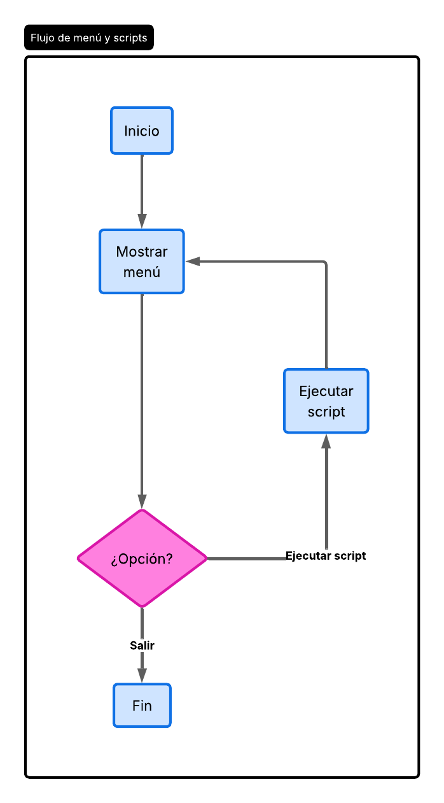
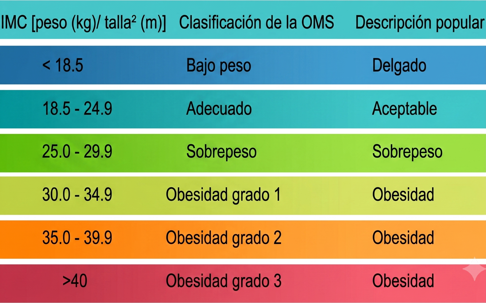
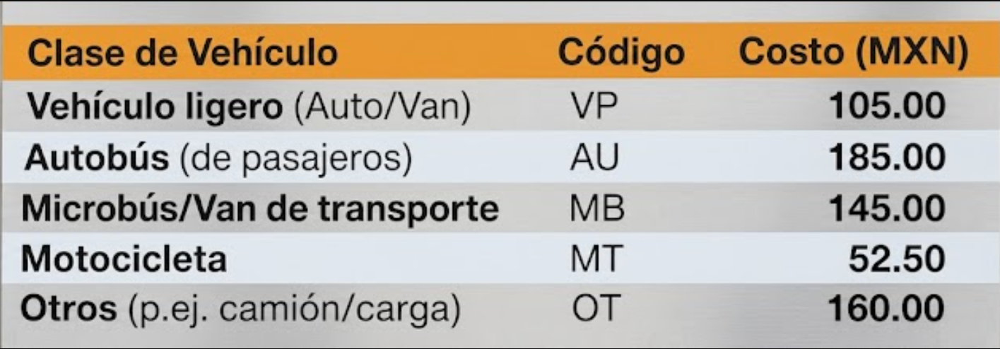
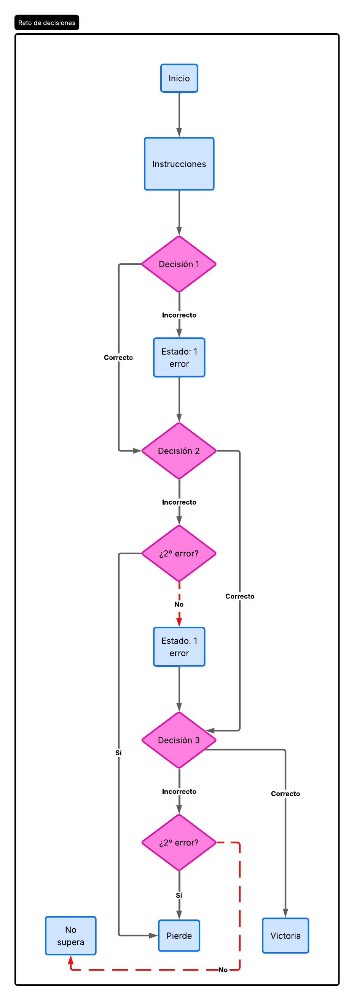
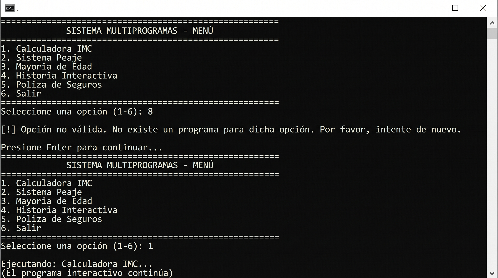
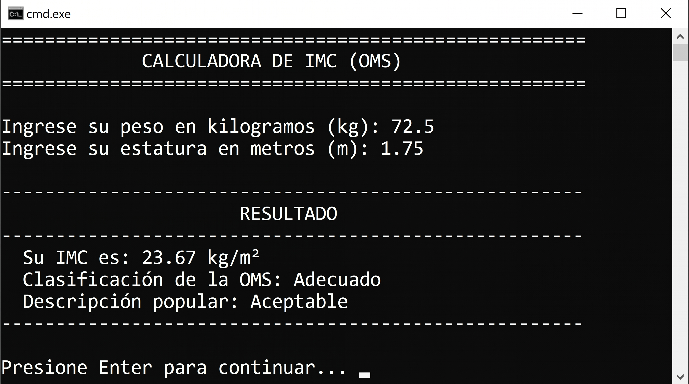
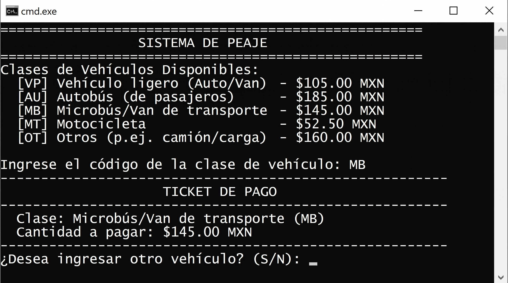
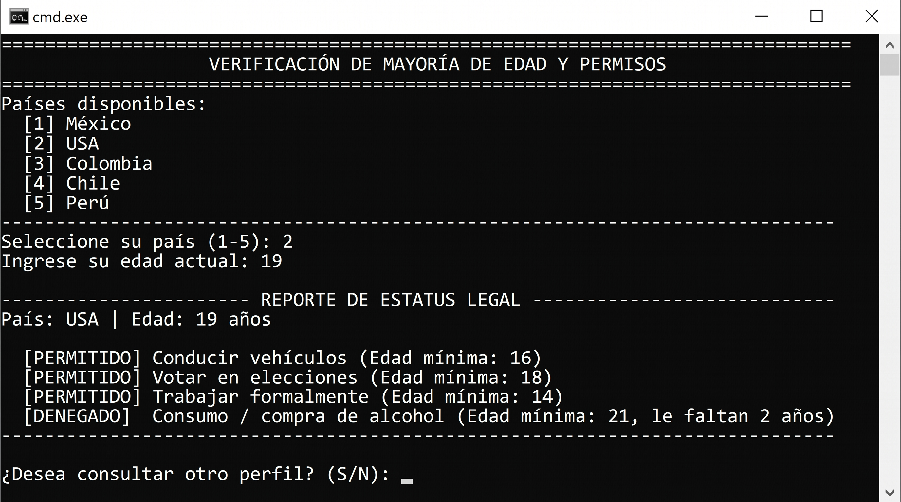
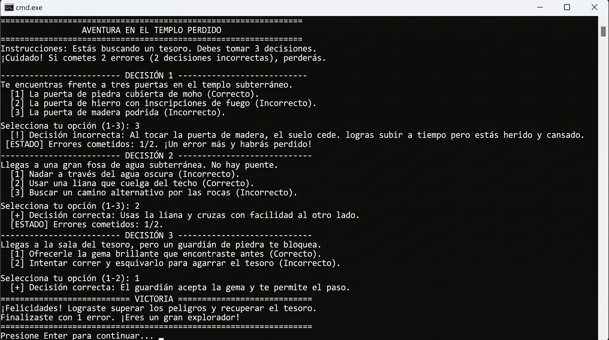
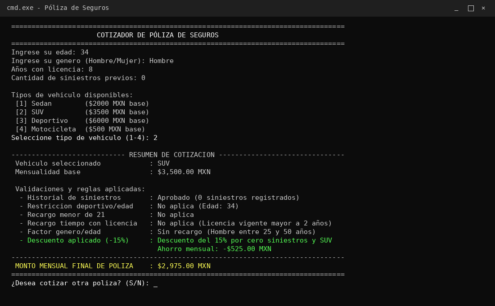

# Repaso estructuras de control

## Introducción ##

> Para reforzar la teoría vista hasta el momento durante el curso, realizaremos una serie de ejercicios que buscan que utilicemos los conocimientos aprendidos sobre estructuras de control para poder resolver una serie de problemas.

## Objetivos ##

> Reforzar la funcionalidad de las estructuras de control; switch, if-else y operador ternario.

### Planteamiento inicial: ###

> Durante los primeros ejercicios del curso, tendremos que elaborar una serie de scripts para repasar los conceptos de teoría aprendidos durante el capitulo, estos ejercicios deben ser desarrollados sobre un mismo programa main, en el deberemos implementar una especie de menu mediante la consola para poder mostrar la información de entrada y salida de los ejercicios.

Dicho lo anterior, antes de comenzar propiamente con los ejercicios ajustados al nivel de dificultad, primero tendremos que elaborar el menu. Por lo que se te pide desarrollar un menu que cumpla con lo siguiente:

* El menu debe mostrar la información de forma ininterrumpida una y otra vez hasta que el programa detecte que el usuario seleccione que quiere terminar el programa.

> Considera el uso de un ciclo do while para desarrollar este menu

* Mostrar la información de que "botones" permiten al usuario acceder y utilizar alguno de los respectivos programas que vamos a desarrollar.

* Usando una estructura de control deberás validar el dato de entrada proporcionado por el usuario comparándolo contra las opciones descritas en el menu siendo que de haber una coincidencia proceda a ejecutar el código correspondiente, de no haber una opción adecuada, indicarle al usuario que no existe un programa para dicha opción y repetir el programa.

### Ejercicios fáciles: ###

1) Calculadora IMC

Con base a la información de la siguiente imagen:

Elabora un programa que le solicite al usuario la información de su peso y estatura, devolviendo al usuario su IMC mas su clasificación correspondiente según el nombre definido por la OMS.

2) Sistema de Peaje

Con base a la información de la siguiente imagen:

Elabora un programa que le solicite al usuario la información del tipo de vehículo a ingresar por el sistema de peaje, y le devuelva la cantidad a pagar.

3) Mayoría de edad

Con base a la información de la siguiente imagen:

Elabora un programa que le solicite al usuario ingresar la información de que país proviene la persona y cual es su edad. 
Con dicha información, se usaran una serie de bloques if para poder mostrar mensajes customizados, indicando si tiene permitido el realizar las operaciones descritas en la imagen, de modo que cambie la información dependiendo la nacionalidad y su edad.

La ultima fila se ha dejado deliberadamente en blanco para que agregues la información correspondiente a tu caso en particular.

### Ejercicios Intermedios: ###

1) Historia interactiva

Se te pide desarrollar un "mini juego" de una historia interactiva a tu libre imaginación, siendo asi que deberás narrar un escenario inicial y de ahi una serie  de decisiones (de 2 a 3 opciones) siendo una el "camino feliz" y los restantes las respuestas incorrectas, cada opción debe devolver un resultado distinto pero que desemboca en la siguiente decision, este proceso se debe repetir al menos 2 veces adicionales, siendo asi que si el usuario comete dos decisiones incorrectas "pierde" el juego.

2) Póliza de seguros

Se te pide elaborar un programa que solicite al usuario los datos de:
* Edad
* Genero (Hombre o Mujer)
* AñosConLicencia
* CantidadDeSiniestros
* Tipo de vehículo (Sedan, SUV, Deportivo, Motocicleta.)

La mensualidad base del seguro para el Sedan es de 2000.
Para SUV la base del seguro es de 3500.
El Deportivo en cambio tiene un valor inicial de 6000.
Y la motocicleta tiene un valor inicial de 500.

La idea del programa es que debe aplicar distintas validaciones para poder devolver una oferta de cuanto quedaría el seguro con los datos ingresados por el usuario.

Las reglas a programar son las siguientes:

* Si el numero de siniestros es mayor o igual a 3 automáticamente se debe cancelar la solicitud.

* Si es tipo de vehículo es un deportivo y la edad de la persona es menor de 21, se debe cancelar la solicitud.

* En general las solitudes de personas menores a 21, se considera que el monto original se debe multiplicar por 1.15 por cuestiones de riesgos por la corta edad y madurez de la persona.

* Independientemente a la edad de la persona, si tiene menos tiempo con la licencia, deberá pagar un monto extra de 500.

* Si el solicitante es una mujer y es menor a 30 años o mayor a 60 años, se debe multiplicar el valor por 1.02.

* Si el solicitante es un hombre y es menor de 25 años o mayor a 50 años, se debe multiplicar el valor por 1.03.

* Si la cantidad de siniestros es igual a 0 y la edad esta entre 30 y 50 se puede aplicar un descuento del 15%  para los los vehículos Sedan y SUV.

## Resultados esperados ##

